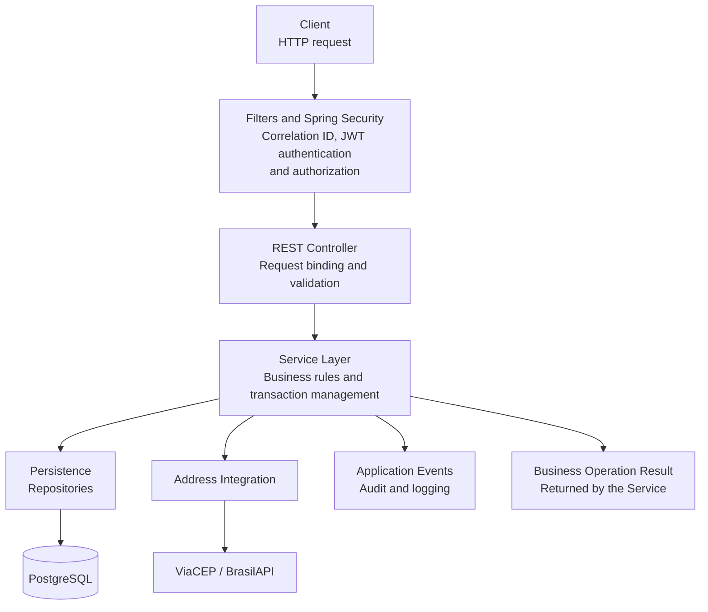
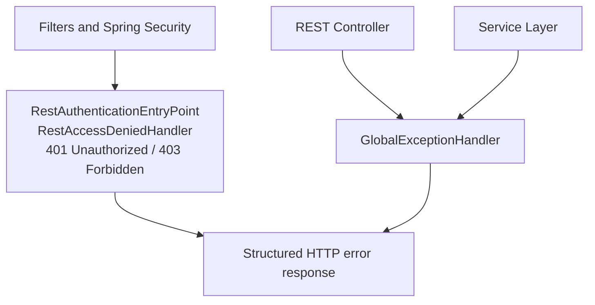

# Architecture

The application follows a modular layered architecture, separating responsibilities into distinct components and layers.

## Package Structure

```text
src/main/java/com/lcsalvess/bankingsystem
├── bootstrap/       # Application startup and initial administrator creation
├── config/          # Jackson, JWT, OpenAPI, pagination, clock, security, and executor configuration
├── controller/      # REST endpoints for accounts, authentication, audit events, clients, transactions, and users
├── dto/             # Request and response DTOs, grouped by domain
├── entity/          # Domain entities and enums, grouped by domain, including audit events
├── event/           # Application events, post-commit log listeners, and the in-transaction audit listener
├── exception/          # Business exceptions, database constraints, error messages, and global handling
├── filter/             # HTTP filters, including correlation ID propagation
├── integration/
│   └── address/        # External address-provider clients and lookup orchestration
│       ├── brasilapi/
│       ├── config/
│       ├── dto/
│       ├── exception/
│       ├── validation/
│       └── viacep/
├── repository/         # Persistence repositories, query specifications, and projections
│   ├── audit/          # Append-only audit event writing and read-only audit queries   
│   ├── idempotency/    # Transaction idempotency persistence
│   ├── projection/     # Read-only query projections
│   └── specification/  # Dynamic filters
├── security/           # JWT authentication filter and JSON handlers for 401/403 responses
├── serialization/      # Custom JSON serialization
├── util/               # Normalization, CPF masking, time-zone, and pagination utilities
├── service/            # Business rules and application logic
│   ├── audit/          # Audit event recording and read-only audit queries
│   ├── account/        # Account operations, row locking, and account number generation
│   ├── address/        # Address-resolution application logic
│   ├── client/         # Client operations and persistence responsibilities
│   ├── security/       # Authentication, JWT, password changes, and current user
│   ├── transaction/    # Financial operations
│   │   ├── balancereconciliation/ # Balance checks and startup recovery
│   │   ├── idempotency/ # Idempotency handling, cleanup, and startup recovery
│   │   └── yield/       # Daily yield processing and startup recovery
│   └── user/           # User operations
└── validation/      # Custom Bean Validation constraints and validators
    ├── accountnumber/      # Account number and check digit validation
    ├── cpf/                # CPF validation
    ├── passwordbytelength/ # BCrypt UTF-8 byte-size limit
    ├── passwordstrength/   # Password complexity requirements
    └── reservedusername/   # Reserved username validation
```

Startup recovery tasks for daily yield processing, transaction idempotency
cleanup, and balance reconciliation use the dedicated
`startupRecoveryExecutor`, keeping them separate from the
`applicationTaskExecutor` used for Spring MVC asynchronous request handling.
The recovery executor has a single worker thread and a queue capacity of two
tasks. These startup recovery tasks run asynchronously after
`ApplicationReadyEvent` and are disabled in the `test` profile.

## Request Flow

The diagram below illustrates the simplified request/response flow, from authentication and authorization through controller and service execution to persistence, external integrations, and response generation.



On successful execution, the service returns the operation result to the
controller, which maps it to a response DTO and produces the HTTP response.

### Error Handling

The following diagram summarizes how authentication, authorization,
request validation, and application errors are converted into HTTP
error responses.


