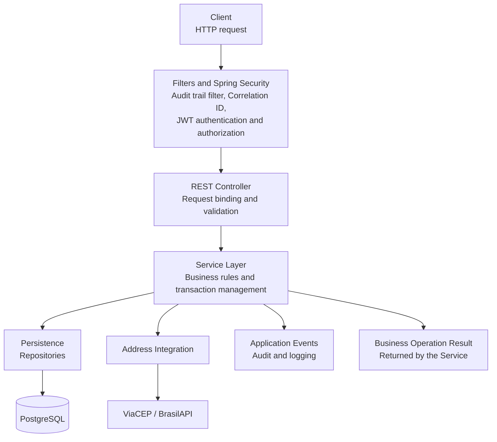
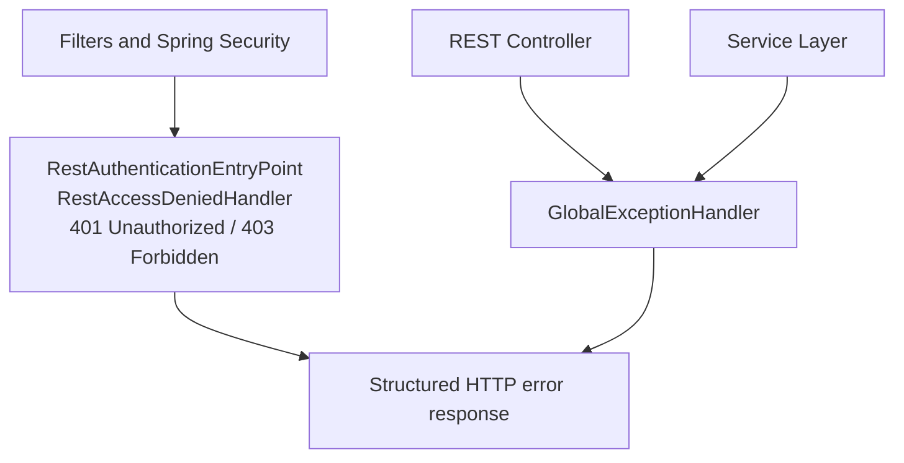

# Architecture

The application follows a modular layered architecture, separating responsibilities into distinct components and layers.

## Package Structure

```text
src/main/java/com/lcsalvess/bankingsystem
├── bootstrap/       # Application startup and initial administrator creation
├── config/          # Jackson, JWT, OpenAPI, pagination, clock, security, and executor configuration
├── controller/      # REST endpoints for accounts, authentication, audit events, clients, transactions, and users
├── dto/             # Request and response DTOs, grouped by domain
├── entity/          # Domain entities and enums, grouped by domain, including audit events
├── event/           # Application events, post-commit log listeners, and the in-transaction audit listener
├── exception/          # Business exceptions, database constraints, error messages, and global handling
├── filter/             # HTTP filters, including correlation ID propagation and HTTP outcome auditing
├── integration/
│   └── address/        # External address-provider clients and lookup orchestration
│       ├── brasilapi/
│       ├── config/
│       ├── dto/
│       ├── exception/
│       ├── validation/
│       └── viacep/
├── repository/         # Persistence repositories, query specifications, and projections
│   ├── audit/          # Append-only audit event writing and read-only audit queries   
│   ├── idempotency/    # Transaction idempotency persistence
│   ├── projection/     # Read-only query projections
│   └── specification/  # Dynamic filters
├── security/           # JWT authentication filter, JSON handlers for 401/403 responses, and audit request attributes
├── serialization/      # Custom JSON serialization
├── util/               # Normalization, CPF masking, time-zone, and pagination utilities
├── service/            # Business rules and application logic
│   ├── audit/          # Audit recording (`recording`), audit queries and their snapshots (`query`), and shared query types (`contract`, `policy`)
│   ├── account/        # Account operations, row locking, and account number generation
│   ├── address/        # Address-resolution application logic
│   ├── client/         # Client operations and persistence responsibilities
│   ├── security/       # Authentication, JWT, password changes, and current user
│   ├── transaction/    # Financial operations
│   │   ├── balancereconciliation/ # Balance checks and startup recovery
│   │   ├── idempotency/ # Idempotency handling, cleanup, and startup recovery
│   │   └── yield/       # Daily yield processing and startup recovery
│   └── user/           # User operations
└── validation/      # Custom Bean Validation constraints and validators
    ├── accountnumber/      # Account number and check digit validation
    ├── cpf/                # CPF validation
    ├── passwordbytelength/ # BCrypt UTF-8 byte-size limit
    ├── passwordstrength/   # Password complexity requirements
    └── reservedusername/   # Reserved username validation
```

Startup recovery tasks for daily yield processing, transaction idempotency
cleanup, and balance reconciliation use the dedicated
`startupRecoveryExecutor`, keeping them separate from the
`applicationTaskExecutor` used for Spring MVC asynchronous request handling.
The recovery executor has a single worker thread and a queue capacity of two
tasks. These startup recovery tasks run asynchronously after
`ApplicationReadyEvent` and are disabled in the `test` profile.

## Request Flow

The diagram below illustrates the simplified request/response flow, from authentication and authorization through controller and service execution to persistence, external integrations, and response generation.



On successful execution, the service returns the operation result to the
controller, which maps it to a response DTO and produces the HTTP response.

### Audit Recording

Audit events follow two paths:

- **In the operation's transaction.** `AuditService#recordSuccess` uses `Propagation.MANDATORY`, so the event commits or rolls back together with the business change. A failure to write it prevents the operation from committing.
- **Outside the transaction.** `AuditTrailRecorder` writes login events and HTTP outcomes through `AuditService#recordDetached` (`REQUIRES_NEW`). It is best-effort, deduplicates repeated events, pauses writes after database availability failures, and must not be called inside an active transaction.

`AuditTrailFilter` is registered as a servlet filter with `Ordered.HIGHEST_PRECEDENCE + 10`, outside the Spring Security chain, and records the outcome in a `finally` block, so it sees the final status of 401/403 responses produced by the security handlers and of requests whose chain throws. Three details connect it to the rest of the request:

- The `SecurityContext` is already cleared when the filter records, so `JwtAuthenticationFilter` stores the authenticated user in a request attribute (`AuditRequestAttributes`).
- `AuditExceptionCaptureResolver` is registered as the first `HandlerExceptionResolver`. It only stores the exception in a request attribute and returns `null`, so `GlobalExceptionHandler` still builds the response.
- `CorrelationIdFilter` runs inside the security chain, so the audit filter reads the correlation ID from the response header rather than from the MDC.

### Audit Queries

`AuditEventQueryService` is a deliberately non-transactional dispatcher: without an `X-Audit-Snapshot` header it calls `AuditEventQuerySnapshotService#createSnapshot`, and with one it calls `findPage`. Keeping the branch outside the snapshot service lets each method run through its Spring proxy, so its own transaction settings (`REQUIRES_NEW`, `REPEATABLE_READ`) apply; calling one from the other inside the same class would bypass them.

Creating a snapshot reads only the matching event IDs (up to 10,001, to detect an oversized result), discards the oldest active snapshots of the auditor beyond the limit, and stores the metadata and one item per position. Later pages read the stored IDs by position and load the events, which are immutable. The snapshot is bound to the auditor and to hashes of the filters and the sort; the page number and size are free. `AuditEventQuerySnapshotCleanupJob` deletes expired snapshots (`banking.audit.snapshot.cleanup-cron`, every 5 minutes by default). The limits are in `AuditEventQueryPolicy`.

### Error Handling

The following diagram summarizes how authentication, authorization,
request validation, and application errors are converted into HTTP
error responses.


